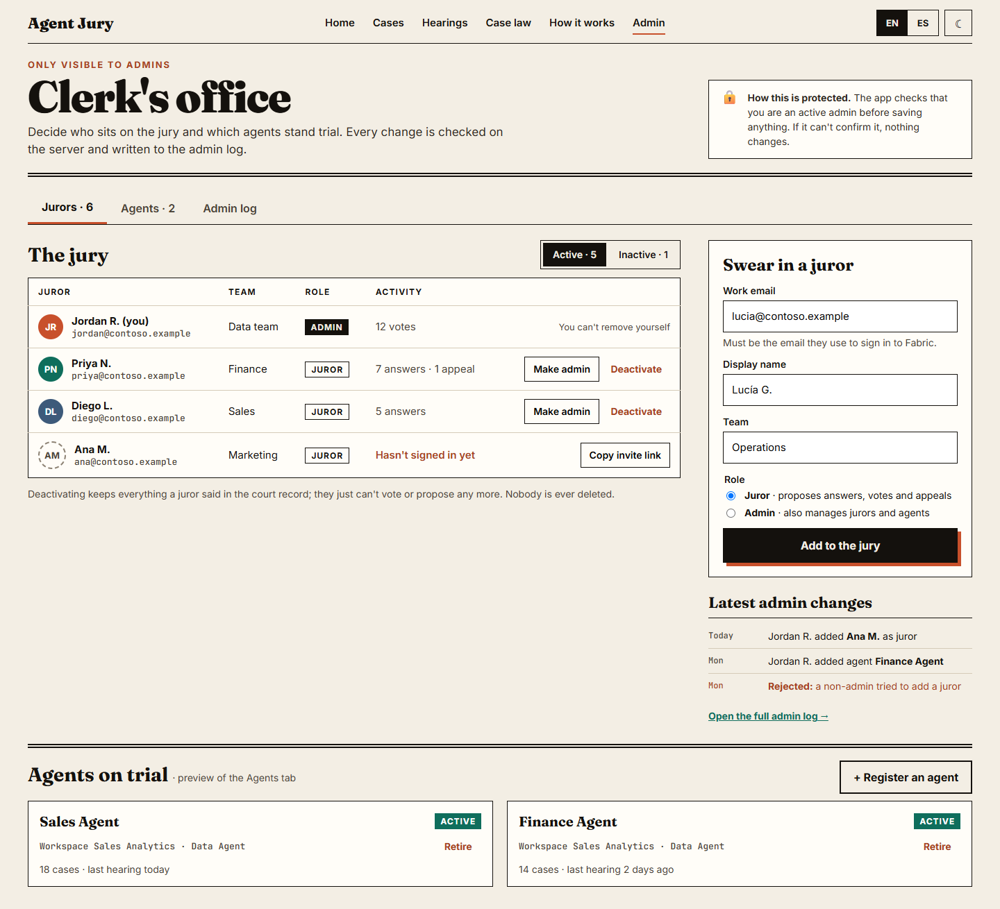

[English](README.md) · Español

# Agent Jury

> **¿Quién juzga al juez?**

Agent Jury es una Microsoft Fabric App en la que expertos de negocio acuerdan las respuestas que debe dar un Fabric Data Agent y después comprueban si el juez de IA que evalúa al agente está de acuerdo con ellos. Los expertos proponen preguntas de prueba con la respuesta que esperan, votan hasta llegar a un acuerdo y corrigen al juez cuando se equivoca en un veredicto. Las respuestas acordadas se convierten en una verdad de referencia reutilizable para el agente.

Los documentos para desarrolladores (especificación, planes de iteración, guía de diseño, convenciones) están en inglés. Los documentos para usuarios (este README, la guía de usuario y el guion de pruebas manuales) están en inglés y en español.


## Vocabulario del tribunal

La app usa una metáfora de juicio. Cada término también se explica dentro de la app.

| Término | Significado |
|---|---|
| **Caso** | Una pregunta de prueba para un agente. |
| **Abierto a votación** | Un caso que todavía no está resuelto ni en disputa: el jurado sigue votando. |
| **Respuesta** (testimonio) | Una respuesta esperada a un caso, con la definición que usó su autor. |
| **Resolución** | El jurado se pone de acuerdo en una respuesta: el caso queda *resuelto*. |
| **Disputa** | Los jurados respaldan respuestas distintas, así que el caso está *en disputa* hasta que se zanje. |
| **Vista** | Una ejecución de evaluación del agente contra los casos resueltos. |
| **Recurso** | Un jurado confirma o corrige el veredicto del juez de IA sobre un caso. |
| **Jurisprudencia** | Los casos resueltos, exportados como verdad de referencia. |

## Guía de usuario

- [Guía de usuario](docs/user-guide.es.md) (ES) / [User guide](docs/user-guide.md) (EN): cómo se juega, roles y reglas (cuándo queda resuelto un caso, disputas, vistas, reapertura, confianza en el juez). El último paso de la Intro y Home enlazan a la copia dentro de la app (`#guide`, generada a partir de estos archivos al compilar con `marked`), porque los jurados pueden no tener acceso al repositorio.
- Guion de pruebas manuales: [Español](docs/manual-test.es.md) / [English](docs/manual-test.md): lista de comprobación de principio a fin para una persona (Prueba A) y para un admin y dos jurados (Prueba B).
- **Empieza en Home, en "Tu turno":** enumera lo que necesita ahora la persona con sesión iniciada (votos, disputas, votos de aprobadores, veredictos del juez por revisar y, para los admins, casos resueltos listos para una vista), calculado con datos ya cargados. Debajo, una tira de progreso (Proponer · Votar · Resuelto · Vista · Revisar) muestra el cuello de botella. Las listas y la página del caso indican qué pasa ahora para esa persona (`src/screens/docket/next-step.ts`, `your-turn.ts`, con pruebas).
- **Idioma del contenido:** las preguntas, respuestas y definiciones no se traducen nunca, porque la pregunta se envía al agente tal cual está escrita. La insignia de idioma requiere un cambio de esquema y espera aprobación ([backlog](docs/iteraciones/backlog.md), en inglés).

## Estado

En desarrollo y en uso por un primer grupo de jurados. El progreso y los siguientes pasos se siguen en [docs/iteraciones/estado.md](docs/iteraciones/estado.md) (en español, documento para desarrolladores); la especificación completa está en [docs/especificacion-general.md](docs/especificacion-general.md).

**Funciona hoy**
- Jurados, agentes, casos, respuestas (testimonios), votos, desestimaciones y las reglas R1–R9 (resolución, disputas, reapertura).
- La Secretaría (admins): jurados, agentes, registro de admin y el interruptor de datos de ejemplo.
- Home ("Tu turno", tira de progreso, ticker), el tablero de casos y la página del caso con votación.
- Vistas: un admin lanza una evaluación del agente; el juez de IA da un veredicto por caso y los jurados lo revisan.
- Confianza en el juez por agente y por versión del prompt crítico, y la exportación de jurisprudencia en CSV.
- Español e inglés, temas claro y oscuro, una pantalla de lanzamiento, una Intro de tres pasos y la guía de usuario dentro de la app. Consulta [Pantalla de lanzamiento e Intro](#pantalla-de-lanzamiento-e-intro).

**Siguiente:** consulta el backlog y los planes de iteración en `docs/iteraciones/` (por ejemplo, mostrar cómo llegó el agente a su respuesta: [spike de trazas I4](docs/iteraciones/I4-trace-spike.md)).

## Requisitos

- Una capacidad de Microsoft Fabric F2 o superior, en una región donde Fabric Apps esté disponible, con la carga de trabajo Fabric Apps activada en el tenant. Los Data Agents y su evaluación necesitan una capacidad de pago (no de prueba) y los Data Agents activados en el tenant.
- Un workspace en esa capacidad en el que seas Colaborador, Miembro o Administrador.
- Node.js 20, 22 o 24, y Git.
- La CLI de Rayfin. Es una dependencia de desarrollo de esta app (`@microsoft/rayfin-cli` 1.36.2), así que `npx rayfin` usa la versión fijada.

## Instalación

Ejecuta todos los comandos desde `apps/agent-jury` salvo que se indique otra cosa.

1. Clona el repositorio e instala las dependencias:

   ```powershell
   git clone <este repositorio>
   cd fabric-atelier/apps/agent-jury
   npm ci
   ```

2. Desde la raíz del repositorio, copia `private.example.env` a `.private/values.env` y rellénalo. Git ignora el archivo, y el hook pre-commit lo usa para bloquear valores privados (consulta el [README raíz](../../README.es.md)).
3. Inicia sesión en Fabric:

   ```powershell
   npx rayfin login
   ```

4. Despliega la app (base de datos, Functions y sitio estático) en tu workspace:

   ```powershell
   npx rayfin up --workspace "<nombre de tu workspace>"
   git restore rayfin/rayfin.yml
   ```

   `rayfin up` añade la URL de la app desplegada a `rayfin/rayfin.yml`. Restaura el archivo después de **cada** despliegue para que la URL de tu tenant no se suba nunca al repositorio.

5. Localiza la base de datos SQL de la app y guarda su servidor y nombre en `.private/values.env`:

   ```powershell
   node scripts/find-app-sql-database.mjs
   ```

6. Conviértete en el primer admin (el email se lee de `.private/values.env`) y carga después los jurados y agentes de ejemplo:

   ```powershell
   node scripts/run-sql.mjs rayfin/seed/admin.sql --var AdminEmail=ACCOUNT_EMAIL
   node scripts/run-sql.mjs rayfin/seed/seed.sql
   ```

7. Ejecuta en local contra el backend desplegado:

   ```powershell
   npm run dev
   ```

Otros comandos: `npm test` (pruebas unitarias), `npm run lint`, `npm run build`.

### Despliegue de pruebas

Las comprobaciones desplegadas se ejecutan contra una segunda copia de la app en su propio workspace, nunca contra producción. Sus ids están en `.private/values.env` (claves que terminan en `_TEST`, consulta `private.example.env`) y en `rayfin/.env.test` (ignorado por Git).

```powershell
node scripts/deploy-test.mjs --set-secrets    # despliega en el workspace de pruebas y vuelve a producción
node scripts/run-sql.mjs rayfin/seed/seed.sql --target=test
node scripts/run-sql.mjs rayfin/seed/docket-examples.sql --target=test   # un caso de ejemplo por estado (solo pruebas)
node scripts/i1a-checks.mjs --expect-admin
node scripts/i1b-checks.mjs
node scripts/i1c-checks.mjs
```

Los scripts de comprobación apuntan por defecto al despliegue de pruebas y rechazan producción salvo que se llamen con `--target=production --allow-production`. Los archivos SQL marcados con `-- target: test-only` se niegan a ejecutarse sin `--target=test`. La compilación de pruebas muestra por defecto los agentes y jurados de ejemplo (`VITE_SHOW_EXAMPLE_AGENTS=1`, lo fija `deploy-test.mjs`); en producción están ocultos salvo que un admin active "Mostrar datos de ejemplo" en la Secretaría (no se borra nada, y la elección se restablece al recargar).

### Lista de comprobación del despliegue a producción

Un despliegue a producción por cada bloque de trabajo terminado. Los cambios solo de interfaz se verifican en local (pruebas, `tsc`, lint, puerto 5180) y van directos a producción; los cambios de esquema, Functions o notebook van antes al despliegue de pruebas.

1. Pasan las pruebas, `tsc` y lint; el trabajo está confirmado (pasan los hooks) y subido a `main`. `deploy-production.mjs` se niega salvo que el árbol esté limpio y `HEAD` sea `origin/main`.
2. **Primero el esquema, o junto con el código:** la entidad `UserFlag` (marcas por usuario como `intro_seen`) debe existir en producción antes de, o en el mismo despliegue que, el código que la lee. La app tolera que falte la entidad (la Intro se da por vista), pero nunca mostraría la Intro ni la recordaría. Lo mismo vale para **`VerdictReview`** (y la columna `Hearing.criticPromptVersion`) con el código de I3b: aplica el esquema (`npx rayfin up db apply`) antes de ese despliegue o junto con él. Home tolera que falte la consulta de revisiones/veredictos (se ocultan la línea de confianza en el juez y las líneas del juez en el ticker), pero los recursos, R9 y la confianza en el juez no hacen nada sin ella.
3. `node scripts/deploy-production.mjs --allow-production` (añade `--set-secrets` solo cuando cambien los secretos). Ejecuta el `rayfin up` completo (esquema incluido) y después restaura `rayfin/rayfin.yml`.
4. Comprobación mínima: lanzamiento, Intro la primera vez y Home al recargar, Vistas carga, sin errores en la consola. No se lanza ninguna vista y nada hace polling.
5. No subas nunca ids de tenant, workspace o item, emails ni URLs de la app (están en `.private/values.env`).

## Pantalla de lanzamiento e Intro

- **La pantalla de lanzamiento** ([guía de diseño 6b](docs/design/design-guide.md), en inglés) es lo primero que se pinta y se queda hasta que terminan la sesión y la carga inicial de datos. Sus tres pasos son trabajo real, no temporizadores: **Sesión** (inicio de sesión en Fabric y el registro del jurado), **Casos** (la carga inicial en paralelo) y **En pie**. Se mantiene al menos unos 800 ms (sin parpadeo), mantiene "En pie" unos 600 ms y, pasados unos 8 s, muestra "tarda más de lo normal" con Reintentar. Nada se reintenta solo: el reintento solo ocurre cuando la persona pulsa. Los errores aparecen dentro como una alerta "¡Protesto!": sesión caducada (iniciar sesión de nuevo), no estás en el jurado (copiar mi nombre de inicio de sesión para enviarlo a un admin; solo se copia al portapapeles al pulsar, nunca se registra ni se guarda) o limitación / 5xx / cualquier otra cosa (Reintentar). El pequeño cargador "El jurado está deliberando…" se mantiene para los cambios de página y las actualizaciones. La lógica está en `src/launch/`: `launch-machine.ts` (máquina de estados pura) y `launch-stages.ts` (pasos y rutas), con pruebas.
- **Idioma y tema antes de cargar el perfil:** la elección guardada de EN/ES si existe; si no, el idioma del navegador; el tema sigue `prefers-color-scheme`.
- **La Intro** tiene tres pasos, se puede saltar en cualquier momento y se muestra una vez por persona: quien entra por primera vez va a la Intro después de la pantalla de lanzamiento y luego a la página que pidió (Home o el enlace directo). Se puede repetir desde Home ("Cómo funciona", `#intro`), y eso no escribe nada.
- **"Intro vista" se guarda por persona en los datos de la app**, en la entidad `UserFlag`, así que la acompaña entre dispositivos. Es de solo inserción (una marca está puesta cuando existe una fila para `userId` y `flag`; los duplicados son inofensivos), cada persona solo puede crear y leer sus propias filas y no guarda email ni nombre. Marcas actuales (constantes en `src/data/user-flags.service.ts`, nunca entrada del usuario):

  | Marca | Significado |
  |---|---|
  | `intro_seen` | La persona terminó o saltó la Intro. |

  Si falla la consulta (por ejemplo, en un despliegue que todavía no tiene la entidad), la app da la Intro por vista en lugar de bloquear a la persona. Despliega el esquema (`rayfin up`) antes que el código que escribe marcas.

## Recursos y confianza en el juez (I3b)

- **Revisar veredictos.** En una vista, cualquier jurado activo responde "Sí, de acuerdo" o "No, recurrir" bajo cada veredicto (teclas A · X · J/K · ?). Una revisión es un `VerdictReview` de solo inserción; cuenta la última de cada jurado y veredicto. Un recurso (una revisión que difiere del juez) necesita un comentario.
- **R9.** Un caso resuelto se reabre con una revisión válida `expected_answer_wrong` de un aprobador activo. Los votos emitidos antes de la revisión siguen visibles en el acta ("antes de la revisión") pero dejan de contar; los jurados vuelven a votar.
- **La confianza en el juez** se calcula por agente y por versión del prompt crítico (otro prompt es otro juez): la versión actual en grande y las anteriores como historial. Las filas con `source` (filas de demostración "seed", filas de scripts "check") nunca cuentan. Home sigue cargando, sin la línea de confianza ni las líneas del juez del ticker, si no se pueden leer los veredictos o las revisiones.
- Plan y decisiones: [docs/iteraciones/I3b.md](docs/iteraciones/I3b.md). Historia de demostración en el despliegue de pruebas: `rayfin/seed/i3b-story-1-ruled-case.sql`, una vista real (`scripts/i3b-run-hearing.mjs`), `rayfin/seed/i3b-story-2-appeal.sql` y después `scripts/i3b-checks.mjs`.

## Exportación de jurisprudencia (I3c)

- **"Exportar jurisprudencia"** en Casos descarga los casos resueltos del agente como un CSV para Quality Lab, generado en el navegador con datos ya cargados (sin consultas, Functions ni esquema nuevos). Cabecera exacta: `question,expected_answer,category,tags`.
- **Qué filas:** casos resueltos de ese agente cuyo autor es un jurado activo, no desestimados y **no reabiertos** (R9), y nunca datos de ejemplo o sembrados (ids de usuario `example-`, direcciones `example.com`). El botón se desactiva, con el motivo como tooltip, cuando no hay nada que exportar o cuando no se pudieron cargar las revisiones (entonces no se puede descartar que haya casos reabiertos).
- **Correspondencia:** `question` = el texto del caso; `expected_answer` = la respuesta resuelta; `category` = la categoría del caso; `tags` = las etiquetas del caso (escritas con comas) más la definición estructurada de la respuesta resuelta como `criterion: …`, `time window: …`, `population: …`, `source: …`, unidas con `;`.
- **Seguridad:** comillas RFC 4180, UTF-8 con BOM, CRLF; las celdas que empiezan por `=`, `+`, `-`, `@` o un tabulador llevan un `'` delante (un número simple como `-5` se deja como está); sin autores, emails ni ids. Nombre del archivo: `agent-jury-<agente>-case-law-<aaaa-mm-dd>.csv`. Código: `src/data/case-law-csv.ts`.

## Modelo de seguridad

- **Los registros son de solo inserción.** Casos, testimonios, desestimaciones, votos, revisiones de veredictos y marcas por usuario no se actualizan ni se borran nunca; cada entrada conserva su autor y su fecha.
- **Las reglas de lectura e inserción están en el modelo de datos.** Leer exige haber iniciado sesión (las solicitudes de admin y sus resultados solo las ve su autor), y las inserciones deben llevar la identidad de quien llama (`claims.sub` / `claims.email`), así que nadie escribe en nombre de otra persona.
- **Los jurados y agentes se escriben solo a través de `clerkExecute`.** El navegador inserta una `AdminRequest` (su política de inserción demuestra quién la pide) y llama a la Function solo con el id de la solicitud. La Function lee la solicitud con T-SQL como identidad de la app y aplica las salvaguardas:
  - ejecuta solo la acción y los datos guardados;
  - cada solicitud se ejecuta una vez;
  - las solicitudes caducan a los 2 minutos;
  - quien la pide debe ser un admin activo;
  - los admins no pueden desactivarse ni quitarse su propio rol de admin.

  Cada resultado, rechazos incluidos, se escribe en `AdminRequestResult`.
- **El cliente no es una frontera de seguridad.** La interfaz oculta las acciones de admin a quien no lo es, pero el servidor comprueba cada solicitud.
- **Los nombres de las Functions no deben empezar por `admin` ni `runtime`.** El host de Azure Functions reserva esas rutas, y esas Functions devuelven NotFound sin ejecutarse.

## Diseño

La dirección visual es "The Docket", un periódico de tribunales. Consulta la [guía de diseño](docs/design/design-guide.md) y las [maquetas](docs/design/mockups/) HTML (ábrelas en un navegador), ambas en inglés. Las imágenes de este README se generan a partir de esas maquetas, que solo contienen datos de ejemplo ilustrativos.



## Estructura

```text
apps/agent-jury/
├── docs/          # Especificación, planes de iteración y guía de diseño
├── fabric/        # Elementos de Fabric fuera de la app (notebooks de evaluación y exportación)
├── rayfin/        # Configuración de Rayfin, modelo de datos, Functions y scripts de datos de ejemplo
├── scripts/       # Comprobaciones desplegadas, ejecutor de SQL y validación de la plantilla
└── src/           # Interfaz en React
```

## Versiones fijadas

| Componente | Versión |
|---|---|
| CLI de Rayfin (`@microsoft/rayfin-cli`) | 1.36.2 |
| `fabric-data-agent-sdk` | 0.1.36a0 (fijada en el notebook `evaluate_agent`) |

## Licencia

MIT, copyright Mónica Mesa. Consulta [LICENSE](../../LICENSE).
