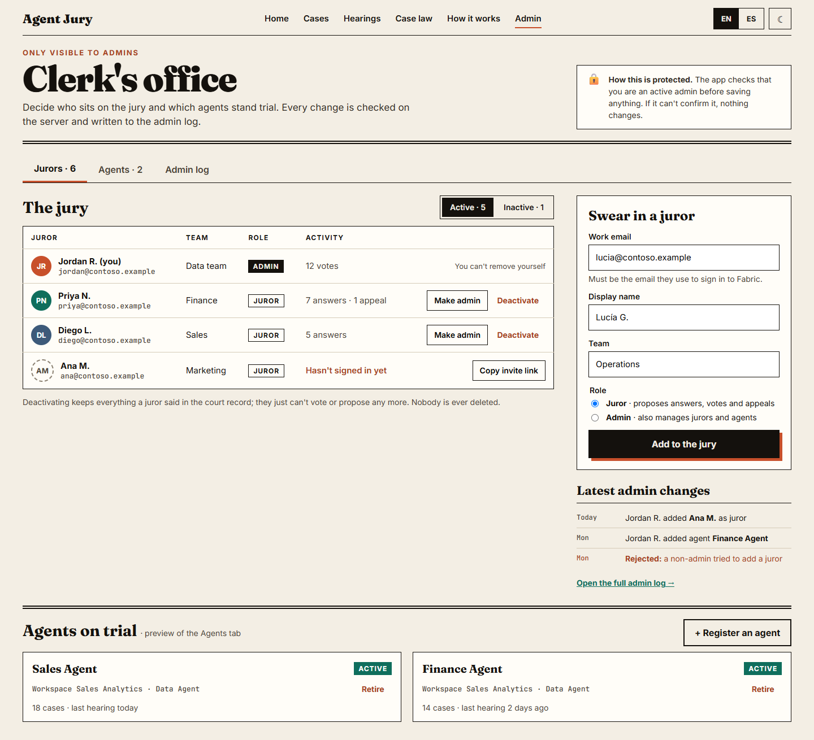

# Agent Jury

> **Who judges the judge?**

Agent Jury is a Microsoft Fabric App where business experts agree on the answers a Fabric Data Agent should give, and then check whether the LLM judge that evaluates the agent agrees with them. Experts propose test questions with the answer they expect, vote until they reach consensus, and correct the judge when it gets a verdict wrong. The agreed answers become reusable ground truth for the agent.


## Court vocabulary

The app uses a trial metaphor. Each term is also explained in the app.

| Term | Meaning |
|---|---|
| **Case** | A test question for an agent. |
| **Testimony** | An expected answer to a case, with the definition its author used. |
| **Ruling** | The jury agrees on one testimony: the case is *ruled*. |
| **Dispute** | Jurors back different answers, so the case is *disputed* until it is settled. |
| **Hearing** | An evaluation run of the agent against the ruled cases. |
| **Appeal** | A juror confirms or corrects the LLM judge's verdict on one case. |
| **Case law** | The ruled cases, exported as ground truth. |

## Status

In development. Progress and next steps are tracked in [docs/iteraciones/estado.md](docs/iteraciones/estado.md) (Spanish); the full specification is in [docs/especificacion-general.md](docs/especificacion-general.md).

**Works today**
- Data model and security rules for jurors, agents, cases, testimonies and dismissals.
- Admin flow through the `clerkExecute` Function, with an admin log that includes rejected attempts.
- The Clerk's office screen to manage jurors and agents.
- English and Spanish, light and dark themes.

**Next**
- Screens 1–3: home docket, cases board and case detail, with voting.
- Hearings: launching agent evaluations and reviewing the judge's verdicts.
- Case law export.

## Requirements

- A Microsoft Fabric capacity, F2 or higher, in a region where Fabric Apps is available, with the Fabric Apps workload enabled in the tenant. Data Agents and their evaluation need a paid capacity (not trial) and Data Agents enabled in the tenant.
- A workspace on that capacity where you are Contributor, Member or Admin.
- Node.js 20, 22 or 24, and Git.
- The Rayfin CLI. It is a dev dependency of this app (`@microsoft/rayfin-cli` 1.36.2), so `npx rayfin` uses the pinned version.

## Setup

Run every command from `apps/agent-jury` unless noted.

1. Clone the repository and install dependencies:

   ```powershell
   git clone <this repository>
   cd fabric-atelier/apps/agent-jury
   npm ci
   ```

2. From the repository root, copy `private.example.env` to `.private/values.env` and fill it in. The file is ignored by Git, and the pre-commit hook uses it to block private values (see the [root README](../../README.md)).
3. Sign in to Fabric:

   ```powershell
   npx rayfin login
   ```

4. Deploy the app (database, Functions and static site) to your workspace:

   ```powershell
   npx rayfin up --workspace "<your workspace name>"
   git restore rayfin/rayfin.yml
   ```

   `rayfin up` adds the deployed app URL to `rayfin/rayfin.yml`. Restore the file after **every** deploy so your tenant's URL is never committed.

5. Find the app's SQL database and store its server and name in `.private/values.env`:

   ```powershell
   node scripts/find-app-sql-database.mjs
   ```

6. Make yourself the first admin (the email is read from `.private/values.env`), then load the example jurors and agents:

   ```powershell
   node scripts/run-sql.mjs rayfin/seed/admin.sql --var AdminEmail=ACCOUNT_EMAIL
   node scripts/run-sql.mjs rayfin/seed/seed.sql
   ```

7. Run locally against the deployed backend:

   ```powershell
   npm run dev
   ```

Other commands: `npm test` (unit tests), `npm run lint`, `npm run build`.

## Security model

- **Records are insert-only.** Cases, testimonies, dismissals, votes and appeals are never updated or deleted; every entry keeps its author and date.
- **Read and insert rules live in the data model.** Reading requires sign-in (admin requests and their results are visible only to their author), and inserts must carry the caller's own identity (`claims.sub` / `claims.email`), so nobody writes on someone else's behalf.
- **Jurors and agents are written only through `clerkExecute`.** The browser inserts an `AdminRequest` (its insert policy proves who asks) and calls the Function with the request id only. The Function reads the request with T-SQL as the app identity and enforces the safeguards:
  - it runs only the stored action and payload;
  - each request runs once;
  - requests expire after 2 minutes;
  - the requester must be an active admin;
  - admins can't deactivate themselves or remove their own admin role.
  
  Every outcome, including rejections, is written to `AdminRequestResult`.
- **The client is not a security boundary.** The UI hides admin actions from non-admins, but the server checks every request.
- **Function names must not start with `admin` or `runtime`.** The Azure Functions host reserves those routes, and such Functions return NotFound without running.

## Design

The visual direction is "The Docket", a court newspaper. See the [design guide](docs/design/design-guide.md) and the HTML [mockups](docs/design/mockups/) (open them in a browser). The images in this README are rendered from those mockups, which contain illustrative example data only.



## Structure

```text
apps/agent-jury/
├── docs/          # Specification, iteration plans and design guide
├── fabric/        # Fabric items outside the app (evaluation and export notebooks)
├── rayfin/        # Rayfin config, data model, Functions and seed scripts
├── scripts/       # Deployed checks, SQL runner and template validation
└── src/           # React frontend
```

## Pinned versions

| Component | Version |
|---|---|
| Rayfin CLI (`@microsoft/rayfin-cli`) | 1.36.2 |
| `fabric-data-agent-sdk` | To be pinned in iteration 3 |
