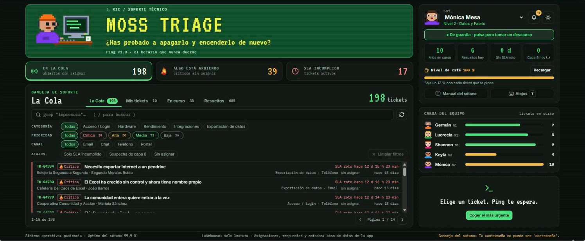
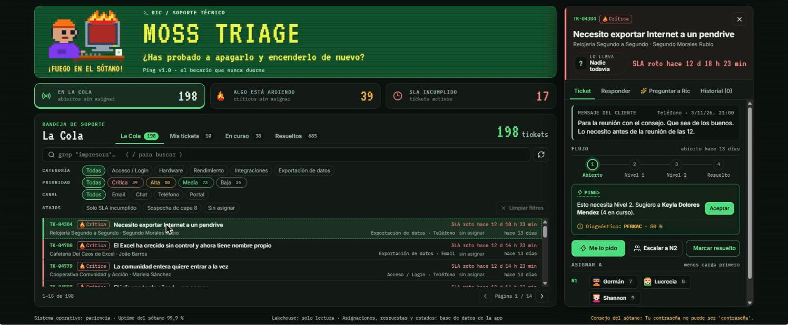
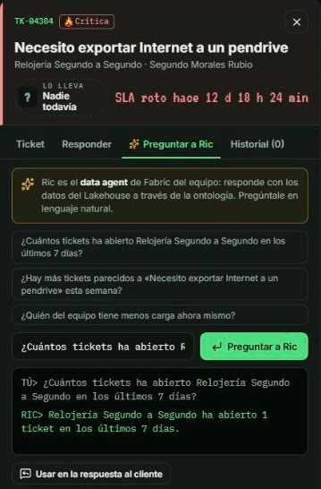
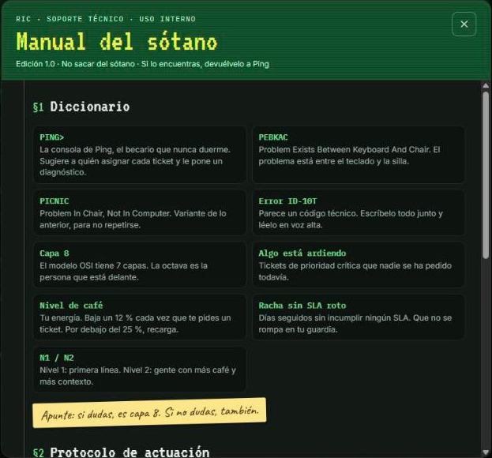

[English](README.md) · Español

# 🔥 Moss Triage

> **¿Has probado a apagarlo y volverlo a encender?**

<p align="center"></p>

Te damos la bienvenida al sótano. Moss Triage es una Fabric App para un servicio de soporte (ficticio) donde los tickets no paran de llegar, el café se acaba y la mitad de los problemas son de capa 8. Los agentes ven los tickets abiertos, se los asignan, los escalan a N2, responden al cliente y los cierran. Y cuando necesitan contexto, le preguntan a **Ric**: un Fabric Data Agent que responde en lenguaje natural sobre los mismos datos, sin salir de la app.



Se creó para la sesión *De «qué interesante» a «esto sí podría usarlo»* (Microsoft Reactor Data Days, noviembre de 2026). La primera demo enseña la ontología de Fabric IQ y el Data Agent; esta demuestra que ese agente puede vivir dentro de una app que la gente usa cada día. Está hecha con **Fabricator** y **VS Code**, y montarla fue divertidísimo.

## El sótano en 30 segundos

1. **Llega un ticket.** Lo ves en el tablero con su prioridad, su canal y la cuenta atrás del SLA. Si algo está ardiendo, lo verás arder.
2. **Ping lo diagnostica.** Ping es el becario que nunca duerme: te sugiere a quién asignarlo y calcula la probabilidad de que sea capa 8.
3. **Te lo pides o lo escalas.** Un clic y es tuyo, o va a N2 («gente con más café»).
4. **Le preguntas a Ric.** «¿Este cliente ya ha tenido este problema?». Ric consulta la ontología y te contesta en unos segundos.
5. **Respondes y cierras.** Con respuestas rápidas incluidas, como «¿Está enchufado?» o «Por favor, no toques nada más».



| ✦ Preguntar a Ric | Manual del sótano |
|---|---|
|  |  |

## Glosario friki

Todo está explicado en el **Manual del sótano**, dentro de la app (tecla `?`).

| Término | Qué significa |
|---|---|
| **PING>** | La consola de Ping, el becario. Sugiere a quién asignar y diagnostica el problema. |
| **Capa 8** | El modelo OSI tiene 7 capas. La octava es la persona que está delante. |
| **PEBKAC** | *Problem Exists Between Keyboard And Chair.* |
| **PICNIC** | *Problem In Chair, Not In Computer.* Para no repetirse. |
| **Error ID-10T** | Parece un código técnico. Escríbelo todo junto. |
| **Nivel de café** | Tu energía: baja un 12 % con cada ticket que te pides. Por debajo del 25 %, recarga. |
| **Racha sin SLA roto** | Días seguidos sin incumplir ningún SLA. Que no se rompa en tu guardia. |
| **N1 / N2** | Primera línea / gente con más café y más contexto. |

**Atajos de teclado:** `J`/`K` siguiente/anterior · `Enter` abrir · `A` asignármelo · `E` escalar a N2 · `R` resuelto · `/` buscar · `?` ayuda.

## Cómo funciona por dentro

| Camino | Por dónde va | Con qué identidad |
|---|---|---|
| Leer tickets, clientes y equipo | Conector `ricsupport` (`fabric-sqlanalytics`) → SQL analytics endpoint del Lakehouse, solo lectura | La app |
| Asignar, escalar, responder, resolver | Servicio de datos de Rayfin → base de datos de la app (`TicketAssignment`, `TicketEvent`) | El usuario que ha iniciado sesión |
| ✦ Preguntar a Ric | Rayfin Function `askRic` → endpoint MCP del Data Agent publicado → ontología de Fabric IQ → Lakehouse | La app (la dueña del elemento) |

- **La app nunca escribe en el Lakehouse:** el estado del flujo vive en su propia base de datos.
- **Ric no se llama desde el navegador.** `askRic` se ejecuta en el servidor: lee el endpoint del secreto `RIC_DATA_AGENT_MCP_URL`, obtiene un token con `ctx.Tokens.Fabric` y habla MCP con el agente (`initialize` → `tools/list` → `tools/call`). Tarda entre 15 y 20 segundos, y mientras tanto la consola de la app va contando.

> **Nota de seguridad.** La identidad de la app es la persona dueña del elemento Fabric App, así que Ric responde con sus permisos. En una demo está bien. Para un uso real, dale a la app una identidad dedicada con el mínimo privilegio y decide en la Function a qué agente puede llamar cada usuario.

La interfaz está **solo en español** (es una demo para público hispanohablante, una excepción a la regla bilingüe de [conventions.md](../../docs/conventions.md)). Ping, los avatares pixelados y todos los datos son originales y ficticios.

## Requisitos

- Todo lo del [README raíz](../../README.es.md#requisitos-comunes).
- Un Lakehouse con tres tablas: `tickets`, `customers` y `support_team`. Las columnas que espera la app están en [`rayfin/connectors/ricsupport/schema.ts`](rayfin/connectors/ricsupport/schema.ts). Los datos de la demo los genera un notebook que no forma parte de este repositorio.
- Un Fabric Data Agent **publicado** sobre esos datos (en la demo, encima de una ontología de Fabric IQ), con su endpoint MCP (agente → *Settings* → *Model Context Protocol*).
- Una capacidad de Fabric de pago (los Data Agents no funcionan en capacidades de prueba).

## Ponla en marcha

Ejecuta todos los comandos desde `apps/moss-triage`.

1. Instala las dependencias:

   ```powershell
   npm.cmd ci
   ```

2. Crea `rayfin/.env` a partir del ejemplo (Git lo ignora) y rellena los IDs del workspace y del Lakehouse:

   ```powershell
   Copy-Item rayfin/.env.example rayfin/.env
   notepad rayfin/.env
   ```

3. Configura el secreto con el endpoint MCP del agente, en local y para la app publicada (Fabricator → *Código* → *Secretos*, o `npx.cmd rayfin secret set RIC_DATA_AGENT_MCP_URL`). En local, las Rayfin Functions lo leen de `packages/functions/local.settings.json`, que Git también ignora.

4. Arráncala:

   ```powershell
   npm.cmd run dev
   ```

## Publicar

```powershell
npx.cmd rayfin up
```

`rayfin up` escribe la URL publicada en `rayfin/rayfin.yml`. No la subas: `allowedRedirectUris` la lee de `MOSS_TRIAGE_APP_URL` en `rayfin/.env`. Después de cada publicación, revisa `git diff rayfin/rayfin.yml` y restaura el fichero si aparece la URL literal (consulta [conventions.md](../../docs/conventions.md#rayfinyml-after-a-deploy)).

## Lecciones aprendidas

Lo que aprendimos por el camino (Fabricator haciendo commits por su cuenta, la pantalla en blanco, el SQL endpoint que se colaba en el repo…) está en [docs/lessons-learned.md](../../docs/lessons-learned.md#9-moss-triage-fabricator-and-a-data-agent-in-an-app) (en inglés).

---

*Si no es capa 8, escala a N2. Si arde: extintor, y avisa a N2.* 🧯
