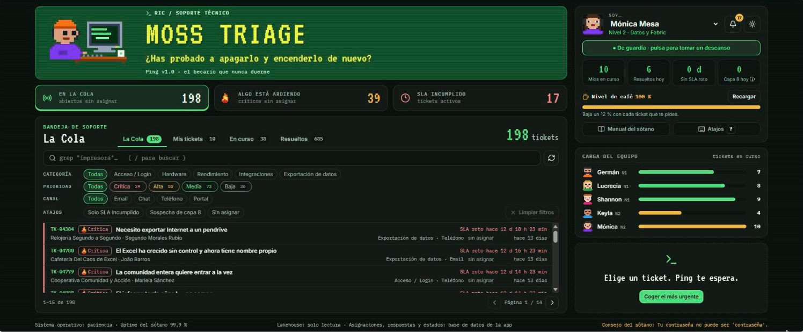
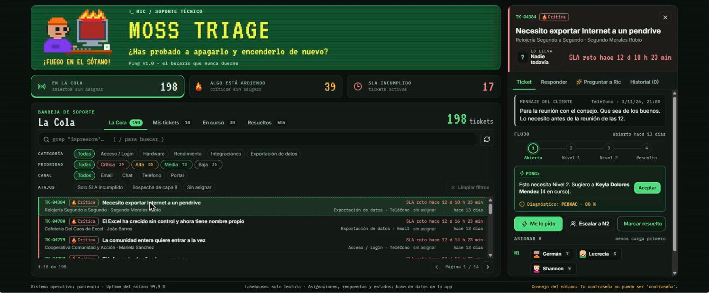
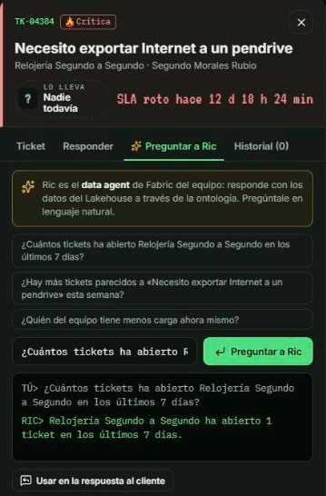
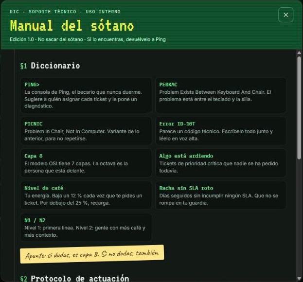

English · [Español](README.es.md)

# 🔥 Moss Triage

> **Have you tried turning it off and on again?**

<p align="center"></p>

Welcome to the basement. Moss Triage is a Microsoft Fabric App for a (fictional) support desk where tickets never stop coming, the coffee always runs out and half of the problems are layer 8. Agents see the open tickets, pick them up, escalate them to level 2, answer the customer and close them. And when they need context, they ask **Ric**: a Fabric Data Agent that answers in plain language over the same data, without leaving the app.



It was built for the session *De «qué interesante» a «esto sí podría usarlo»* (Microsoft Reactor Data Days, November 2026). The first demo shows the Fabric IQ ontology and the Data Agent; this one shows that the agent can live inside an app people use every day. It was built with **Fabricator** and **VS Code**, and it was great fun.

## The basement in 30 seconds

1. **A ticket arrives.** It shows up on the board with its priority, channel and SLA countdown. If something is on fire, you will see it burn.
2. **Ping diagnoses it.** Ping is the intern who never sleeps: it suggests who should take the ticket and estimates how likely it is to be layer 8.
3. **Take it or escalate it.** One click and it is yours, or it goes to N2 ("people with more coffee").
4. **Ask Ric.** "Has this customer had this problem before?" Ric queries the ontology and answers in a few seconds.
5. **Reply and close.** Quick replies included, such as "Is it plugged in?" or "Please don't touch anything else".



| ✦ Asking Ric | Manual del sótano (the in-app guide) |
|---|---|
|  |  |

## Geek glossary

The interface is **in Spanish only** (it is a demo for a Spanish-speaking audience, an exception to the bilingual rule in [conventions.md](../../docs/conventions.md)), so here is what the basement slang means. It is all explained in the in-app **Manual del sótano** (press `?`).

| Term | Meaning |
|---|---|
| **PING>** | Ping's console. Ping is the intern: it suggests who to assign and diagnoses the problem. |
| **Capa 8** (layer 8) | The OSI model has 7 layers. The eighth is the person in front of the screen. |
| **PEBKAC** | *Problem Exists Between Keyboard And Chair.* |
| **PICNIC** | *Problem In Chair, Not In Computer.* So you don't repeat yourself. |
| **Error ID-10T** | Looks like an error code. Write it without the dash. |
| **Nivel de café** (coffee level) | Your energy: it drops 12% with every ticket you take. Below 25%, refill. |
| **Racha sin SLA roto** (streak) | Days in a row without a breached SLA. Don't break it on your shift. |
| **N1 / N2** | First line / people with more coffee and more context. |

**Keyboard shortcuts:** `J`/`K` next/previous · `Enter` open · `A` assign to me · `E` escalate to N2 · `R` resolved · `/` search · `?` help.

## How it works

| Path | Through | Identity |
|---|---|---|
| Read tickets, customers and team | `ricsupport` connector (`fabric-sqlanalytics`) → SQL analytics endpoint of the Lakehouse, read only | The app |
| Assign, escalate, reply, resolve | Rayfin data service → app database (`TicketAssignment`, `TicketEvent`) | The signed-in user |
| ✦ Ask Ric | Rayfin Function `askRic` → MCP endpoint of the published Data Agent → Fabric IQ ontology → Lakehouse | The app (the item owner) |

- **The app never writes to the Lakehouse:** the workflow state lives in its own database.
- **Ric is not called from the browser.** `askRic` runs on the server: it reads the endpoint from the `RIC_DATA_AGENT_MCP_URL` secret, gets a token with `ctx.Tokens.Fabric` and talks MCP to the agent (`initialize` → `tools/list` → `tools/call`). It takes 15–20 seconds, and the app's console counts them meanwhile.

> **Security note.** The app identity is the owner of the Fabric App item, so Ric answers with the owner's permissions. That is fine for a demo. For real use, give the app a dedicated identity with least privilege, and decide in the Function which agent each user may call.

Ping, the pixel avatars and all the data are original and fictional.

## Requirements

- Everything in the [root README](../../README.md#common-requirements).
- A Lakehouse with three tables: `tickets`, `customers` and `support_team`. The columns the app expects are in [`rayfin/connectors/ricsupport/schema.ts`](rayfin/connectors/ricsupport/schema.ts). The demo data is generated by a notebook that is not part of this repository.
- A **published** Fabric Data Agent over that data (in the demo, on top of a Fabric IQ ontology), with its MCP endpoint (agent → *Settings* → *Model Context Protocol*).
- A paid Fabric capacity (Data Agents do not run on trial capacities).

## Run it

Run every command from `apps/moss-triage`.

1. Install the dependencies:

   ```powershell
   npm.cmd ci
   ```

2. Create `rayfin/.env` from the example (it is ignored by Git) and fill in the workspace and Lakehouse IDs:

   ```powershell
   Copy-Item rayfin/.env.example rayfin/.env
   notepad rayfin/.env
   ```

3. Set the secret with the agent's MCP endpoint, for local and for the published app (Fabricator → *Code* → *Secrets*, or `npx.cmd rayfin secret set RIC_DATA_AGENT_MCP_URL`). Locally, Rayfin Functions read it from `packages/functions/local.settings.json`, which is also ignored by Git.

4. Start it:

   ```powershell
   npm.cmd run dev
   ```

## Deploy

```powershell
npx.cmd rayfin up
```

`rayfin up` writes the deployed URL into `rayfin/rayfin.yml`. Do not commit it: `allowedRedirectUris` reads it from `MOSS_TRIAGE_APP_URL` in `rayfin/.env`. After each deploy, check `git diff rayfin/rayfin.yml` and restore the file if the literal URL appears (see [conventions.md](../../docs/conventions.md#rayfinyml-after-a-deploy)).

## Lessons learned

What we learned on the way (Fabricator committing on its own, the blank preview, the SQL endpoint sneaking into the repo…) is in [docs/lessons-learned.md](../../docs/lessons-learned.md#9-moss-triage-fabricator-and-a-data-agent-in-an-app).

---

*If it's not layer 8, escalate to N2. If it's on fire: extinguisher, then tell N2.* 🧯
